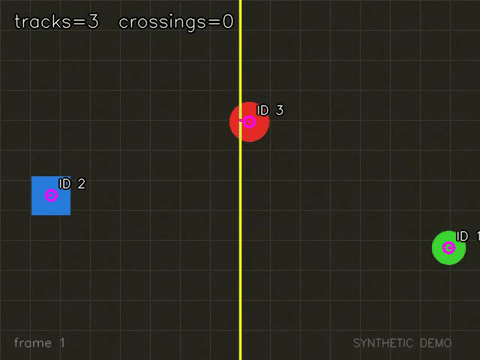

# 03 · 视频分析工具箱

同一个可执行文件，三种模式：背景建模、稠密光流、颜色目标跟踪 + 虚拟越线计数。每种模式都输出标注视频和逐帧 CSV。



## 三种模式

| 模式 | 算法 | 适合回答的问题 | 输出 |
|---|---|---|---|
| `motion` | MOG2 背景减除 + 形态学 + 轮廓 | 画面里哪里在动？有几个运动目标？ | 前景掩膜统计、目标框 |
| `flow` | Farneback 稠密光流 + HSV 方向/幅度可视化 | 运动方向、速度分布 | 平均/最大光流幅度 |
| `track` | HSV 饱和度阈值 + 质心跟踪 + 越线判定 | 目标轨迹、越线次数 | 轨迹 ID、坐标、越线次数 |

演示视频是程序合成的 640×480 / 30 fps / 240 帧：一个红色圆点左右往返，一个绿色圆点从右向左，一个蓝色方块从左向右，中间有一条虚拟计数线。

## 运行

```bash
# 运动检测
./build/bin/video_analytics \
    --input assets/generated/demo_video.mp4 \
    --mode motion --output outputs/video-motion

# 稠密光流
./build/bin/video_analytics \
    --input assets/generated/demo_video.mp4 \
    --mode flow --output outputs/video-flow

# 跟踪 + 越线计数
./build/bin/video_analytics \
    --input assets/generated/demo_video.mp4 \
    --mode track --output outputs/video-track
```

也支持摄像头（索引）和实时预览：

```bash
./build/bin/video_analytics --input 0 --mode motion --gui
```

### 常用参数

| 参数 | 默认值 | 说明 |
|---|---|---|
| `--input` | 必填 | 视频路径或摄像头索引（如 `0`） |
| `--mode` | `motion` | `motion` / `flow` / `track` |
| `--output` | `outputs/video` | 输出目录 |
| `--max-frames` | 0 | 最多处理多少帧，0 表示全部 |
| `--no-video` | 关 | 只写 CSV，不写视频 |
| `--gui` | 关 | 实时显示，ESC 退出 |

## 输出

```
outputs/video-track/
├── annotated.mp4
└── stats.csv
```

CSV 字段：

- `motion`：`frame,objects,foreground_area,elapsed_ms`
- `flow`：`frame,mean_magnitude,max_magnitude,elapsed_ms`
- `track`：`frame,track_id,x,y,right_side,track_crossings,total_crossings,elapsed_ms`

## 结果

| 模式 | 帧数 | 关键指标 | 平均耗时 |
|---|---|---|---|
| `motion` | 240 | 平均 2.9 个运动目标 | 2.3 ms/帧 |
| `flow` | 240 | 平均光流幅度 0.3–2 px | 29.6 ms/帧 |
| `track` | 240 | 5 次越线 | 1.2 ms/帧 |

越线事件（按轨迹拆分）：

| 帧 | 轨迹 | 目标 | 该轨迹累计越线 | 全局累计 |
|---|---|---|---|---|
| 61 | #3 | 红圆（右→左） | 1 | 1 |
| 111 | #2 | 蓝方块（左→右） | 1 | 2 |
| 121 | #3 | 红圆（左→右） | 2 | 3 |
| 122 | #1 | 绿圆（右→左） | 1 | 4 |
| 181 | #3 | 红圆（右→左） | 3 | 5 |

## 实现细节

- **MOG2**：`history=500, varThreshold=25, detectShadows=true`；先阈值 200 去掉阴影（阴影值通常 127），再做开运算 + 膨胀。
- **Farneback**：`pyr_scale=0.5, levels=3, winsize=15, iterations=3, poly_n=5, poly_sigma=1.2`；方向和幅度转成 HSV 后与原始帧混合，方向即颜色。
- **跟踪**：饱和度阈值分割彩色目标 → 轮廓质心 → 最近邻匹配（120 px 门限）→ 连续 15 帧丢失则删除；质心跨过中线（带 3 px 迟滞）时计数，避免在线上抖动重复计数。
- **不写死帧率**：从 `CAP_PROP_FPS` 读取，异常时回退 25 fps。
- **视频写入容错**：优先 `mp4v`，失败时回退 `avc1`；都失败则只写 CSV，不中断处理。

## 局限

- 固定相机假设；相机移动时 MOG2 会整体失效，需要背景补偿或光流补偿。
- `track` 模式基于颜色阈值，适合教学和颜色鲜明的目标；真实场景应换成检测器（YOLO）+ 多目标跟踪（ByteTrack/DeepSORT）。
- MOG2 前几十帧是背景学习期，统计会偏高。
- 越线计数是单条垂直线、单方向累计；多线、多区域、方向过滤可以继续扩展。

## 对应课程

整合自这些练习：

- [archive/labs/1/BackgroundAnalysis/opencv4_039.cpp](../archive/labs/1/BackgroundAnalysis/opencv4_039.cpp)（MOG2）
- [archive/labs/1/OpticalFlowAnalysis/opencv4_040.cpp](../archive/labs/1/OpticalFlowAnalysis/opencv4_040.cpp)（LK 稀疏光流）
- [archive/labs/1/OpticalFlowAnalysis/opencv4_041.cpp](../archive/labs/1/OpticalFlowAnalysis/opencv4_041.cpp)（Farneback 稠密光流）
- [archive/labs/1/ObjectTracking/opencv4_038.cpp](../archive/labs/1/ObjectTracking/opencv4_038.cpp)（颜色阈值跟踪）
- [archive/labs/1/VideoProcessing/opencv4_042.cpp](../archive/labs/1/VideoProcessing/opencv4_042.cpp)（CamShift）
