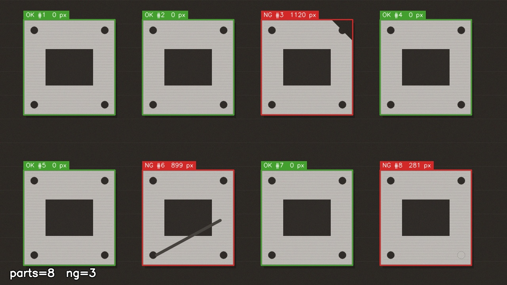
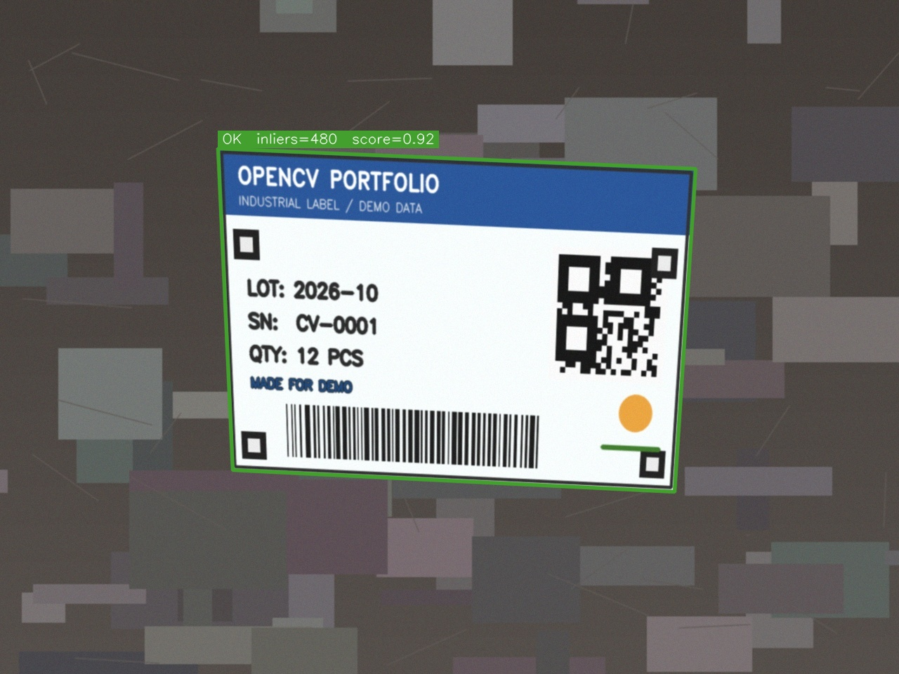
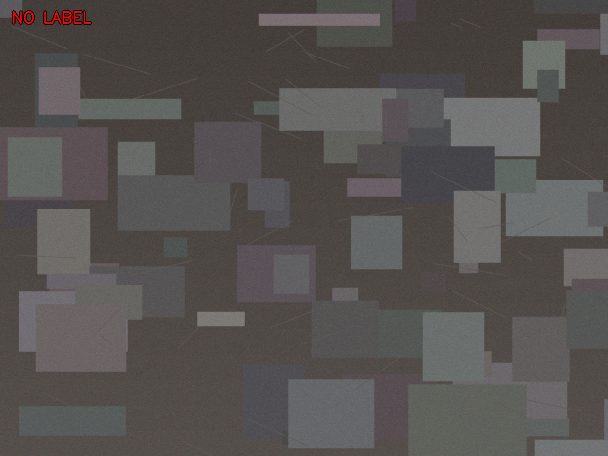
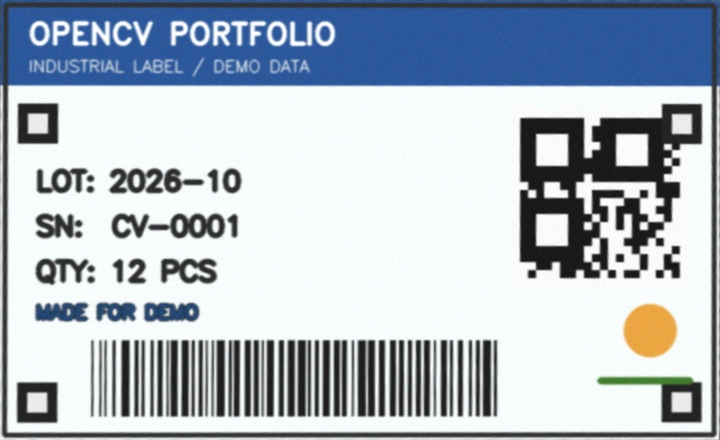
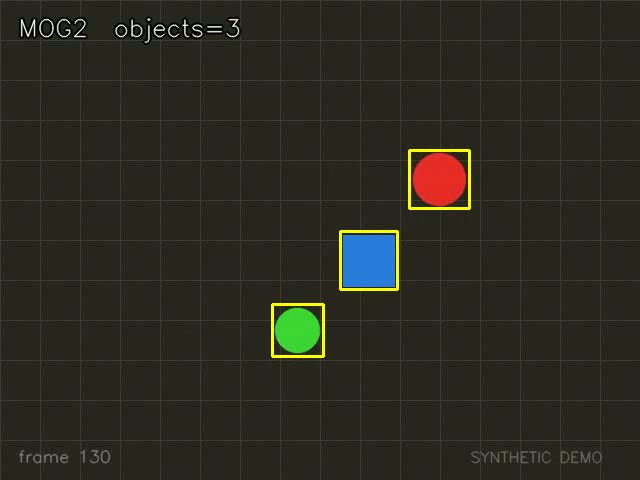
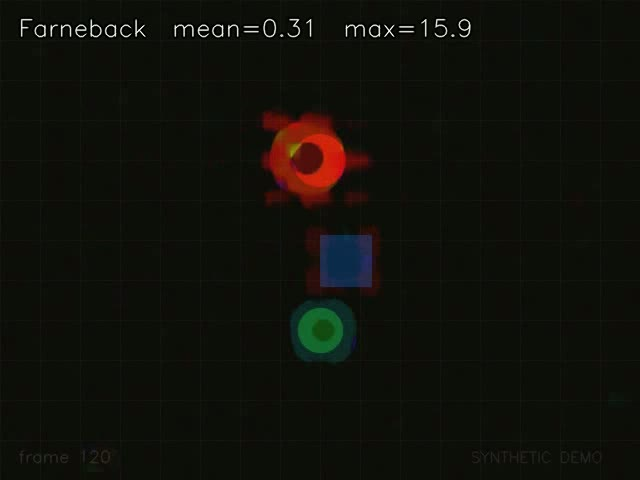

# OpenCV Portfolio

> 从 29 节基础课 + 35 个练习，到 3 个能独立运行、有指标、可复现的计算机视觉项目。

这个仓库记录了我学习 OpenCV 4 的完整过程：先用 `QuickDemo` 跟完 29 节基础课，再按知识点做了 35 个独立练习，最后把其中最有价值的部分重构成三个小项目。每个项目都有明确的输入输出、命令行参数、CSV 报告和演示脚本。


## 三个项目一览

| # | 项目 | 解决的问题 | 方法 | 结果 |
|---|------|-----------|------|------|
| 01 | [工业缺陷检测](01-defect-inspection/README.md) | 8 个零件里哪些有缺陷？ | OTSU 二值化 → 轮廓排序 → 首件模板 → `absdiff` → 形态学 → 像素计数 | 3 个 NG 全部命中，0 误检，0.85 ms/图 |
| 02 | [标签定位](02-label-localization/README.md) | 标签在不在？在哪？怎么摆正？ | ORB + Lowe ratio + RANSAC 单应性 → 透视矫正 | 2 OK / 1 NG，480/521 inliers，约 18 ms/图 |
| 03 | [视频分析](03-video-analytics/README.md) | 画面里有什么在动？越线几次？ | MOG2 背景建模 / Farneback 光流 / 颜色跟踪 + 越线计数 | 240 帧 5 次越线，1–30 ms/帧 |

> 时间是 Apple Silicon、Release、样例尺寸下的实测值，只用于横向比较，不是 benchmark。

## 演示

### 01 · 缺陷检测：模板比对定位 chip / scratch / missing hole



### 02 · 标签定位：找到标签、估计单应性、输出矫正图



| 缺失标签（NG） | 矫正后的标签 |
|---|---|
|  |  |

### 03 · 视频分析：MOG2 / 光流 / 跟踪

| MOG2 运动检测 | Farneback 稠密光流 |
|---|---|
|  |  |

## 快速开始

依赖：CMake ≥ 3.20、支持 C++20 的编译器、OpenCV 4.x（macOS 上实测 4.12.0）。

```bash
git clone https://github.com/CasomTheseus/opencv-portfolio.git
cd opencv-portfolio
./scripts/run_all.sh
```

`run_all.sh` 会依次完成：构建 → 生成合成数据 → 跑三个项目 → 把结果写到 `outputs/`。

macOS 安装依赖：

```bash
brew install opencv cmake
```

如果机器上只装了 CLion，构建脚本会自动回退到 CLion 自带的 CMake。

### 手动构建与运行

```bash
cmake -S . -B build -DCMAKE_BUILD_TYPE=Release
cmake --build build -j

# 生成演示数据（模板、场景图、合成视频）
./build/bin/make_demo_data --what all --out assets

# 01 缺陷检测
./build/bin/defect_inspection \
    --input assets/defect_parts.png --output outputs/defect

# 02 标签定位
./build/bin/label_localization \
    --template assets/label_template.png \
    --input assets/labels --output outputs/labels

# 03 视频分析（motion / flow / track）
./build/bin/video_analytics \
    --input assets/generated/demo_video.mp4 \
    --mode track --output outputs/video-track
```

每个可执行文件都支持 `--help`，例如 `./build/bin/defect_inspection --help`。

## 目录结构

```
opencv-portfolio/
├── 01-defect-inspection/     # 工业缺陷检测
├── 02-label-localization/    # ORB + RANSAC 标签定位
├── 03-video-analytics/       # MOG2 / 光流 / 跟踪
├── common/                   # 头文件公共库：参数、时间、绘图、文件
├── tools/                    # make_demo_data：合成图像与视频
├── assets/                   # 可复现的演示数据
├── docs/                     # 学习日志、演示图
├── archive/                  # 原始课程练习（仅源码，路径已脱敏）
├── scripts/                  # build / run_all / make_docs_images
└── CMakeLists.txt
```

## 设计要点

- **三个独立可执行文件**，不再用 `#define RUN_MAIN` 切换入口；同一时间可以分别运行，互不干扰。
- **统一的 CLI 风格**：`--input`、`--output`、`--help`，不写死任何绝对路径。
- **结果落盘**：图片/视频 + CSV 报告，方便做指标对比和二次分析。
- **数据可复现**：所有演示图、视频都由 `tools/make_demo_data.cpp` 生成，clone 后不依赖外部素材。
- **公共库只做薄封装**：参数解析、计时、绘图、文件遍历集中在 `common/`，项目本身保持单文件易读。

## 学习历程

完整时间线、课程映射和重构记录见 [docs/learning-log.md](docs/learning-log.md)。

简单说：

- **2025-07 ~ 2025-09**：学完 29 节 OpenCV 基础课，完成 35 个独立练习，覆盖图像处理、形态学、轮廓、霍夫、视频、光流、特征匹配、DNN 推理和三个工业案例。
- **2026-10**：把课程代码重构成三个项目，补上构建系统、CLI、CSV 报告、演示数据和文档，并修掉了原始代码中的若干 bug。
- 原始练习保留在 [archive/](archive/README.md)，作为学习轨迹。

## 数据与隐私

- `assets/` 下的标签模板、标签场景、零件阵列和演示视频全部由程序合成，不含真实个人信息。
- `assets/defect_blades.jpg` 是课程练习用的工件照片，仅作对照保留，默认演示不使用。
- 原标签案例使用的真实卡片照片包含个人金融信息，**未纳入本仓库**；已替换为合成标签。
- 人脸检测模型（2.7 MB）和 MobileNet-SSD 模型（23 MB）未入库，避免仓库膨胀和许可问题。

## 局限

- 三个项目都是 2D、固定相机、固定光照假设下的算法演示，不是产线级方案。
- 缺陷检测依赖“首件模板 + 同姿态”假设；旋转、尺度变化大时需要先配准。
- 标签定位对弱纹理、重复纹理和强反光敏感；阈值是针对演示数据调的。
- 视频跟踪基于颜色阈值，适合教学演示；真实场景需要检测器 + 多目标跟踪。
- 尚未包含：相机标定、深度学习训练、ONNX/TensorRT 部署、GUI。

## License

[MIT](LICENSE)
